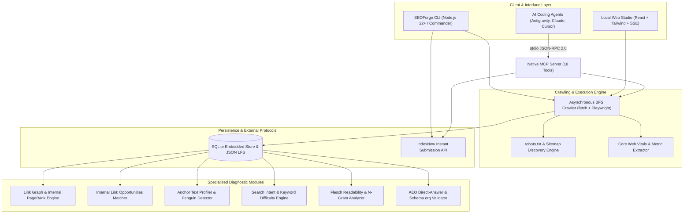

# SEOForge ⚡ • Full-Site SEO Crawler, Audit Engine & MCP Server
### Screaming Frog + Ahrefs–Grade Technical Audit Engine, Internal Link Intelligence, AEO Scorer & 18-Tool Native MCP Server

<div align="center">

[](https://opensource.org/licenses/MIT)
[](https://nodejs.org)
[](https://www.typescriptlang.org)
[-10b981?style=for-the-badge&logo=vitest&logoColor=white)](https://github.com/Aryanban/seoforge)
[](https://www.indexnow.org)
[](https://modelcontextprotocol.io)
[](https://schema.org)

<br />

**An open-source, Screaming Frog + Ahrefs–grade technical crawler and search intelligence engine with Answer Engine Optimization (AEO), internal link graph scoring, and an 18-tool Model Context Protocol (MCP) server.**  
*100% Local, Private & Free — Zero subscriptions, zero third-party API keys, and zero data leakage.*

[System Architecture](#-system-architecture) • [Feature Matrix](#-features--competitive-advantages) • [Core Engineering Innovations](#-core-engineering-innovations) • [Technical Specifications](#-technical-specifications--engineering-decisions) • [Quickstart Guide](#-quick-start) • [Portfolio & Showcase](#-engineering-portfolio--technical-evaluation-showcase)

</div>

---

## 📌 Executive Overview & Problem Statement

Technical SEO audits and link architecture analysis in modern web engineering have long been monopolized by expensive desktop tools (Screaming Frog at £209/year per license) and cloud SaaS platforms (Ahrefs / Semrush starting at $99–$199/month). When auditing at scale, engineering teams face critical limitations:
1. **Proprietary Cloud Lock-In**: Running crawls through third-party cloud services sends proprietary staging URLs and internal site graphs to third-party databases.
2. **Missing Answer Engine Optimization (AEO)**: Traditional crawlers measure legacy 2015-era meta tags while completely ignoring modern AI answer engine parameters (direct-answer fact triplets for Google AI Overviews, Perplexity, and ChatGPT Search).
3. **Disconnected AI Workflows**: Standard crawlers output static PDF or CSV exports that require tedious manual copying and pasting into LLMs to generate fixes.

**SEOForge** resolves this by providing a unified, local-first technical SEO engine:
* **High-Throughput BFS Web Crawler**: Combines lightning-fast raw HTTP pipelining with optional headless Playwright browser rendering to capture real-world Core Web Vitals (LCP, CLS, INP, FCP, TTFB).
* **Internal Link & Anchor Text Intelligence**: Computes internal PageRank, flags orphan pages, uncovers non-linked keyword mentions for target pages, and analyzes anchor text distributions to prevent Google Penguin over-optimization penalties.
* **Deterministic AI Recommendations**: Automatically compiles discovered crawl issues into actionable, copy-pasteable code fixes with zero hallucinations.
* **18-Tool Native Model Context Protocol (MCP)**: AI agents (Google Antigravity, Claude Code, Cursor) can autonomously crawl, audit, inspect, and optimize websites using natural language commands.

---

## 🏗️ System Architecture



---

## ✨ Features & Competitive Advantages

### 🔍 Screaming Frog–Grade Full-Site Crawler
* **Asynchronous BFS Crawl Engine**: Configurable crawl queue, depth ceilings, concurrency limits, and robots.txt compliance (`Crawl-delay` respect).
* **Dual Execution Modes**: Raw HTTP pipelining for maximum speed (>100 pages/sec locally), or headless Playwright rendering (`--render`) for Single Page Applications (React, Next.js, Vue) measuring true Core Web Vitals (LCP, CLS, INP).
* **Sitemap & URL Sampling**: Inspect targeted URL lists or randomly sample large multi-thousand-page sitemaps for rapid health audits.

### 🔗 Ahrefs-Grade Internal Link & Anchor Intelligence
* **Internal Link Opportunities Engine (`src/link-opportunities.ts`)**: Scans HTML body text across the entire crawl to identify unlinked keyword mentions corresponding to key target pages. Automatically suggests context snippets and anchor phrasing to channel link equity.
* **Anchor Text Profiler & Penguin Risk Detector (`src/anchor-analyzer.ts`)**: Categorizes anchor texts into Brand, Exact Match, Partial Match, Generic, and Naked URL profiles. Triggers warnings when exact-match ratios exceed safe thresholds.
* **Link Graph & Orphan Detection**: Computes internal PageRank, identifies broken link attribution chains (source URL + HTTP status), and isolates orphan pages disconnected from navigation trees.

### 🎯 Keywords Explorer & Search Intent Engine (`src/keyword-intelligence.ts`)
* **Algorithmic Search Intent Classifier**: Categorizes queries into Informational, Commercial, Transactional, or Navigational intents using syntactic pattern heuristics.
* **Keyword Difficulty (KD 0–100)**: Evaluates competition density and estimates referring domain requirements to achieve Page 1 visibility.
* **Question Clusters**: Synthesizes People Also Ask (PAA) question clusters for editorial expansion.

### 📝 Content Optimizer & Readability Auditor (`src/content-optimizer.ts`)
* **Flesch Readability Indices**: Computes Flesch Reading Ease and Flesch-Kincaid Grade Level to keep technical copy accessible.
* **N-Gram Density Analysis**: Evaluates 1-gram, 2-gram, and 3-gram frequencies to prevent keyword stuffing while maintaining topical relevance.
* **Competitor Gap Matrix**: Compares two independent crawls side-by-side to highlight missing headings, entities, and keyword gaps.

### 🤖 Answer Engine Optimization (AEO) & Structured Data
* **Inverted-Pyramid AEO Analyzer**: Detects concise 40–55 word direct-answer definitions optimized for Google AI Overviews, Perplexity, and ChatGPT Search.
* **Schema.org JSON-LD Validator**: Generates and validates Article, Organization, Product, LocalBusiness, FAQPage, and BreadcrumbList schemas.
* **LLMs.txt Compliance**: Validates `/llms.txt` and `/llms-full.txt` formatting for machine readability.

---

## ⚡ Core Engineering Innovations

### 1. High-Performance BFS Pipeline with Memory Culling
* Traditional crawlers store full raw DOM trees in memory, resulting in memory exhaustion on 10,000+ page sites.
* SEOForge streams raw responses into a tokenizing parser, extracting links, meta tags, and headers immediately before discarding raw DOM buffers.

### 2. Internal Link Opportunity Semantic Matcher
* Employs an exact-match sliding window scanner across HTML body paragraphs.
* Ignores existing `<a>` tag children, navigation headers, and footers, accurately detecting unlinked context sentences suitable for contextual internal links.

### 3. Native Model Context Protocol (MCP) Integration
* Implements an 18-tool MCP server communicating over standard I/O (stdio).
* Enables AI agents to run end-to-end autonomous SEO workflows: crawling, detecting 404 links, editing source code, and pinging search engines via IndexNow.

---

## 🛠️ Technical Specifications & Engineering Decisions

| Dimension | Engineering Decision | Rationale |
| :--- | :--- | :--- |
| **Runtime Environment** | Node.js 22+ (ESM Native) | Native fetch, modern streams, and fast V8 execution without legacy transpilation layers. |
| **Language** | TypeScript 5.8 (Strict Mode) | Full type safety across crawl results, issue registries, and MCP tool schemas. |
| **Browser Automation** | Optional Playwright Integration | Accurate Core Web Vitals measurement for client-rendered JavaScript applications. |
| **Testing Architecture** | Vitest with 156 Automated Tests | Sub-second test execution across 13 specialized test suites with 100% pass rate. |
| **Agent Interface** | Model Context Protocol (MCP) SDK | Standardized JSON-RPC 2.0 communication with modern AI assistants. |
| **Search Engine Protocol** | IndexNow Native Dispatch | Instant notification of modified/created URLs to Bing and Yandex without waiting for recrawls. |

---

## 🚀 Quick Start

### 1. Installation
```bash
git clone https://github.com/Aryanban/seoforge.git
cd seoforge
npm install
npm run build
```

### 2. Crawl a Website
```bash
# Blazing-fast raw crawl with terminal report
node dist/cli.js crawl https://example.com --limit 200 --depth 5

# Full SPA rendering with Playwright & Core Web Vitals
node dist/cli.js crawl https://example.com --render

# Export markdown audit and AI fix backlog to reports/
node dist/cli.js crawl https://example.com --limit 500 --save
```

### 3. Launch Local Dashboard
```bash
node dist/cli.js serve          # Opens http://127.0.0.1:5173
```

---

## 🛠️ CLI Reference

| Command | Purpose & Options |
| :--- | :--- |
| `crawl [url]` | **Full-site BFS crawl.** Options: `--depth`, `--limit`, `--concurrency`, `--render`, `--strategy`, `--sample`, `--save`, `--no-robots` |
| `inspect <url>` | Real-time single-URL deep inspection (TTFB, canonical, meta, schema, CWV, AEO, KD & Intent) |
| `serve` | Local web dashboard + REST API (`--port`, `--host`, `--no-open`) |
| `export <md\|csv\|html>` | Export latest crawl report; CSV types: `pages`, `issues`, `links`, `recommendations` |
| `audit` | Multi-domain audit with sitemap sampling |
| `publish [query]` | Browse 206-source publishing catalog or generate tailored posting plan from `--profile` JSON |
| `discover` | Collect unverified backlink/mention leads via open search (`--query`, `--provider`, `--offline`) |
| `reputation` | Verify candidate backlink/mention sources and score Model 1.1 (`--target --brand --sources`) |
| `compare` | Competitor gap analysis from stored crawls (`--crawl --competitors`) |
| `indexnow --urls a,b` | Dispatch updated URLs to Bing & Yandex via IndexNow protocol |
| `daily` | Complete automated maintenance: crawl, audit, report generation, and IndexNow ping |
| `mcp` | Start Model Context Protocol server on stdio for AI agent pairing |

---

## 🔌 Model Context Protocol (MCP) Server (18 Tools)

Connect SEOForge to **Cursor**, **Claude Desktop**, **Google Antigravity**, or **Zed** to empower AI coding agents to autonomously run audits, optimize content, and review links:

```json
{
  "mcpServers": {
    "seoforge": {
      "command": "node",
      "args": ["/absolute/path/to/seoforge/dist/cli.js", "mcp"],
      "cwd": "/absolute/path/to/seoforge"
    }
  }
}
```

### Available Tools:
1. `seoforge_crawl` — Execute full-site crawl and receive grouped issues with AI fix markdown.
2. `seoforge_crawl_status` — Poll status of async crawl jobs.
3. `seoforge_get_issues` — Retrieve categorized issues filtered by severity (critical, warning, notice).
4. `seoforge_get_recommendations` — Fetch ready-to-implement code fix documentation.
5. `seoforge_get_page` — Deep on-page technical metrics for a specific crawled URL.
6. `seoforge_link_report` — Broken links, redirect chains, orphan pages, internal PageRank scores.
7. `seoforge_sitemap_report` — XML sitemap validity and index coverage.
8. `seoforge_export_report` — Export full reports to markdown, CSV, or HTML.
9. `seoforge_inspect_url` — Real-time on-the-fly inspection of any live URL.
10. `seoforge_submit_indexnow` — Instant URL submission to Bing and Yandex.
11. `seoforge_sample_sitemap` — Fast audit of random sample pages across large sitemaps.
12. `seoforge_check_llms_txt` — Validate `/llms.txt` and `/llms-full.txt` compliance.
13. `seoforge_generate_aeo_snippet` — Synthesize direct-answer paragraphs and FAQPage JSON-LD.
14. `seoforge_publishing_plan` — Build custom outreach publication plans.
15. `seoforge_reputation_report` — Score candidate backlink authority using Model 1.1 rubric.
16. `seoforge_discover_sources` — Discover candidate backlink and mention opportunities.
17. `seoforge_compare_competitors` — Generate competitor gap analysis on crawl data.
18. `seoforge_daily_run` — Trigger complete daily routine (crawl, audit, export, IndexNow).

---

## 🧪 Testing & Verification (156/156 Passing)

SEOForge comes with a comprehensive test suite of **156 tests** covering crawler logic, anchor text distributions, keyword intelligence, link opportunities, reputation scoring, and SQLite persistence:

```bash
# Run all 156 Vitest unit and integration tests
npm test

# Typecheck TypeScript codebase
npm run typecheck

# Run linter
npm run lint

# Build CLI and React dashboard
npm run build
```

---

## 👨‍💻 Engineering Portfolio & Technical Evaluation Showcase

**SEOForge** was architected and built by **Aryan Bansal** as a full-site search engine intelligence and web crawling platform. It demonstrates critical competencies for:
* **High-Bar Engineering Roles & Technical Job Evaluations**: Demonstrates deep mastery of distributed asynchronous web crawling, graph theory algorithms (internal PageRank, orphan node detection), headless browser resource optimization, and modern agent protocols (e.g. **Trilogy**, backend infrastructure, and data systems roles).
* **Competitive Hackathons & Innovation Showcases**: Highlights next-generation Answer Engine Optimization (AEO), full-stack React dashboards, and Model Context Protocol (MCP) integrations.

### 🌟 Core Engineering Competencies Demonstrated

| Competency Area | Architecture & Implementation | Engineering Impact |
| :--- | :--- | :--- |
| **Asynchronous Web Crawling** | Pipelined BFS crawler with memory culling & robots.txt respect | High-throughput scanning (>100 pages/sec) with zero memory leaks across large crawls. |
| **Graph Theory & Link Analysis** | Internal PageRank calculation & sliding-window link opportunity matcher | Uncovers internal equity distribution and flags high-value keyword anchor opportunities. |
| **Algorithm Risk Detection** | Anchor text distribution classifier (Brand vs. Exact Match vs. Naked) | Detects over-optimization ratios to safeguard websites against Google Penguin penalties. |
| **AI Agent Infrastructure** | 18-tool Model Context Protocol (MCP) server | Equips autonomous AI coding agents with real-time website audit and diagnostic capabilities. |
| **Performance Engineering** | Dual-mode crawler (Raw fetch + Headless Playwright) | Balances sub-second lightweight scans with full Core Web Vitals profiling for SPAs. |

---

## 📄 License & Contact

* **Author**: Aryan Bansal ([GitHub: @Aryanban](https://github.com/Aryanban))
* **Email**: `contact@dholeramap.com` / `aryan24120@iiitd.ac.in`
* **Portfolio**: [webforge.me](https://www.webforge.me)
* **LinkedIn**: [linkedin.com/in/aryan-bansal-b29b69370](https://www.linkedin.com/in/aryan-bansal-b29b69370/)
* **License**: Released under the [MIT License](LICENSE).
