# SEOForge ⚡ • Full-Site SEO Crawler, Audit Engine & 35-Tool MCP Server
### Screaming Frog + Ahrefs–Grade Technical Audit Engine, Internal Link Intelligence, AEO Scorer & Universal AI Agent Server

<div align="center">

[](https://opensource.org/licenses/MIT)
[](https://nodejs.org)
[](https://www.typescriptlang.org)
[-10b981?style=for-the-badge&logo=vitest&logoColor=white)](https://github.com/Aryanban/seoforge)
[](https://modelcontextprotocol.io)
[](https://www.indexnow.org)
[](AGENTS.md)

<br />

**The free, open-source, local-first alternative to Screaming Frog (£209/yr) and Ahrefs ($129/mo).**  
*Full asynchronous BFS web crawler, internal PageRank calculator, Answer Engine Optimization (AEO) scorer, and a 35-tool Model Context Protocol (MCP) server for autonomous AI agents.*  
*100% Local, Private & Free — Zero subscriptions, zero API keys, zero cloud lock-in, and zero data leakage.*

[System Architecture](#-system-architecture) • [Competitive Matrix](#-why-seoforge-vs-expensive-saas) • [Universal Agent Setup](#-universal-agent-setup-claude-cursor-antigravity-chatgpt-opencode) • [Feature Matrix](#-features--competitive-advantages) • [Quickstart Guide](#-quick-start) • [Star & Fork](#-why-fork-seoforge)

</div>

---

## 🏆 Why SEOForge vs. Expensive SaaS?

| Feature | SEOForge ⚡ | Screaming Frog | Ahrefs / Semrush | Sitebulb |
| :--- | :---: | :---: | :---: | :---: |
| **Annual Price** | **$0 (100% Free & Open Source)** | £209 / yr per seat | $1,548 – $2,388 / yr | $162 – $420 / yr |
| **Page Crawl Limits** | **Unlimited (Local SQLite)** | 500 (Free) / Paid req. | Quota-gated credits | License tier limited |
| **AI Agent Native (MCP)** | **Yes (35 Native Tools)** | ❌ No | ❌ No | ❌ No |
| **Multi-Harness Support** | **Claude, Antigravity, Cursor, Codex, OpenCode** | ❌ No | ❌ No | ❌ No |
| **Answer Engine Opt (AEO)** | **Yes (Google AI Overviews & Perplexity)** | ❌ No | ❌ No | ❌ No |
| **Instant IndexNow Dispatch** | **Yes (Bing, Yandex, Naver)** | ❌ Plugin / API required | ❌ No | ❌ No |
| **Data Privacy & Telemetry** | **100% Localhost (Zero Leakage)** | Local, but proprietary | Cloud-hosted data | Local, but proprietary |
| **Headless SPA Rendering** | **Yes (Built-in Playwright)** | Yes (Chromium) | Cloud headless | Yes (Chromium) |
| **Direct AST Code Patcher** | **Yes (`seoforge_patch_codebase`)** | ❌ No | ❌ No | ❌ No |

---

## 🤖 Universal Agent Setup (Claude, Cursor, Antigravity, ChatGPT, OpenCode)

SEOForge connects to any agent harness via the standard Model Context Protocol (MCP):

### 1. Claude Desktop & Claude Code
Add to `claude_desktop_config.json`:
```json
{
  "mcpServers": {
    "seoforge": {
      "command": "npx",
      "args": ["-y", "seoforge", "mcp"]
    }
  }
}
```
Or via Claude Code CLI: `claude mcp add seoforge -- npx -y seoforge mcp`

### 2. Google Antigravity (AGY) & Gemini
Add to `~/.gemini/antigravity/mcp_config.json`:
```json
{
  "mcpServers": {
    "seoforge": {
      "command": "npx",
      "args": ["-y", "seoforge", "mcp"]
    }
  }
}
```

### 3. Cursor & Windsurf
Add to `.cursor/mcp.json` or `~/.codeium/windsurf/mcp_config.json`:
```json
{
  "mcpServers": {
    "seoforge": {
      "command": "npx",
      "args": ["-y", "seoforge", "mcp"]
    }
  }
}
```

### 4. OpenAI Codex CLI & ChatGPT Search Agents
Add to `~/.codex/config.toml`:
```toml
[mcp_servers.seoforge]
command = "npx"
args = ["-y", "seoforge", "mcp"]
```

### 5. OpenCode (`opencode.json`)
```json
{
  "mcp": {
    "seoforge": {
      "type": "local",
      "command": ["npx", "-y", "seoforge", "mcp"],
      "enabled": true
    }
  }
}
```

---

## 🔗 Integration with Claude SEO & Blog Ecosystem

SEOForge is integrated directly into [`Aryanban/claude-seo`](https://github.com/Aryanban/claude-seo) as an official extension (`seo-seoforge`). You can drive SEOForge seamlessly from `/seo seoforge crawl <url>` or through unified multi-agent orchestrators!

---

## 📌 Executive Overview & Problem Statement

Technical SEO audits and link architecture analysis in modern web engineering have long been monopolized by expensive desktop tools (Screaming Frog at £209/year per license) and cloud SaaS platforms (Ahrefs / Semrush starting at $99–$199/month). When auditing at scale, engineering teams face critical limitations:
1. **Proprietary Cloud Lock-In**: Running crawls through third-party cloud services sends proprietary staging URLs and internal site graphs to third-party databases.
2. **Missing Answer Engine Optimization (AEO)**: Traditional crawlers measure legacy 2015-era meta tags while completely ignoring modern AI answer engine parameters (direct-answer fact triplets for Google AI Overviews, Perplexity, and ChatGPT Search).
3. **Disconnected AI Workflows**: Standard crawlers output static PDF or CSV exports that require tedious manual copying and pasting into LLMs to generate fixes.

**SEOForge** resolves this by providing a unified, local-first technical SEO engine:
* **High-Throughput BFS Web Crawler**: Combines lightning-fast raw HTTP pipelining with optional headless Playwright browser rendering to capture real-world Core Web Vitals (LCP, CLS, INP, FCP, TTFB).
* **Internal Link & Anchor Text Intelligence**: Computes internal PageRank, flags orphan pages, uncovers non-linked keyword mentions for target pages, and analyzes anchor text distributions to prevent Google Penguin over-optimization penalties.
* **Deterministic AI Recommendations**: Automatically compiles discovered crawl issues into actionable, copy-pasteable code fixes with zero hallucinations.
* **18-Tool Native Model Context Protocol (MCP)**: AI agents (Google Antigravity, Claude Code, Cursor) can autonomously crawl, audit, inspect, and optimize websites using natural language commands.

---

## 🏗️ System Architecture

```mermaid
flowchart TD
    subgraph ClientLayer ["Client & Interface Layer"]
        CLI["SEOForge CLI (Node.js 22+ / Commander)"]
        Dashboard["Local Web Studio (React + Tailwind + SSE)"]
        AIAgents["AI Coding Agents (Antigravity, Claude, Cursor)"]
    end

    subgraph CoreEngine ["Crawling & Execution Engine"]
        Crawler["Asynchronous BFS Crawler (fetch + Playwright)"]
        RobotsParser["robots.txt & Sitemap Discovery Engine"]
        CWVScorer["Core Web Vitals & Metric Extractor"]
    end

    subgraph IntelligenceLayer ["Specialized Diagnostic Modules"]
        LinkGraph["Link Graph & Internal PageRank Engine"]
        LinkOpp["Internal Link Opportunities Matcher"]
        AnchorProfiler["Anchor Text Profiler & Penguin Detector"]
        KeywordIntel["Search Intent & Keyword Difficulty Engine"]
        ContentOpt["Flesch Readability & N-Gram Analyzer"]
        AEOAnalyzer["AEO Direct-Answer & Schema.org Validator"]
    end

    subgraph StorageLayer ["Persistence & External Protocols"]
        Store[("SQLite Embedded Store & JSON LFS")]
        IndexNowProtocol["IndexNow Instant Submission API"]
    end

    CLI --> Crawler
    Dashboard --> Crawler
    AIAgents -->|"stdio JSON-RPC 2.0"| MCPServer["Native MCP Server (18 Tools)"]
    MCPServer --> Crawler

    Crawler --> RobotsParser
    Crawler --> CWVScorer
    Crawler --> Store

    Store --> LinkGraph
    Store --> LinkOpp
    Store --> AnchorProfiler
    Store --> KeywordIntel
    Store --> ContentOpt
    Store --> AEOAnalyzer

    CLI --> IndexNowProtocol
    MCPServer --> IndexNowProtocol
```



---

## ✨ Features & Competitive Advantages

### 🔍 Screaming Frog–Grade Full-Site Crawler
* **Asynchronous BFS Crawl Engine**: Configurable crawl queue, depth ceilings, concurrency limits, and robots.txt compliance (`Crawl-delay` respect).
* **Dual Execution Modes**: Raw HTTP pipelining for maximum speed (>100 pages/sec locally), or headless Playwright rendering (`--render`) for Single Page Applications (React, Next.js, Vue) measuring true Core Web Vitals (LCP, CLS, INP).
* **Sitemap & URL Sampling**: Inspect targeted URL lists or randomly sample large multi-thousand-page sitemaps for rapid health audits.

### 🔗 Ahrefs-Grade Internal Link & Anchor Intelligence
* **Internal Link Opportunities Engine (`src/link-opportunities.ts`)**: Scans HTML body text across the entire crawl to identify unlinked keyword mentions corresponding to key target pages. Automatically suggests context snippets and anchor phrasing to channel link equity.
* **Anchor Text Profiler & Penguin Risk Detector (`src/anchor-analyzer.ts`)**: Categorizes anchor texts into Brand, Exact Match, Partial Match, Generic, and Naked URL profiles. Triggers warnings when exact-match ratios exceed safe thresholds.
* **Link Graph & Orphan Detection**: Computes internal PageRank, identifies broken link attribution chains (source URL + HTTP status), and isolates orphan pages disconnected from navigation trees.

### 🎯 Keywords Explorer & Search Intent Engine (`src/keyword-intelligence.ts`)
* **Algorithmic Search Intent Classifier**: Categorizes queries into Informational, Commercial, Transactional, or Navigational intents using syntactic pattern heuristics.
* **Keyword Difficulty (KD 0–100)**: Evaluates competition density and estimates referring domain requirements to achieve Page 1 visibility.
* **Question Clusters**: Synthesizes People Also Ask (PAA) question clusters for editorial expansion.

### 📝 Content Optimizer & Readability Auditor (`src/content-optimizer.ts`)
* **Flesch Readability Indices**: Computes Flesch Reading Ease and Flesch-Kincaid Grade Level to keep technical copy accessible.
* **N-Gram Density Analysis**: Evaluates 1-gram, 2-gram, and 3-gram frequencies to prevent keyword stuffing while maintaining topical relevance.
* **Competitor Gap Matrix**: Compares two independent crawls side-by-side to highlight missing headings, entities, and keyword gaps.

### 🤖 Answer Engine Optimization (AEO) & Structured Data
* **Inverted-Pyramid AEO Analyzer**: Detects concise 40–55 word direct-answer definitions optimized for Google AI Overviews, Perplexity, and ChatGPT Search.
* **Schema.org JSON-LD Validator**: Generates and validates Article, Organization, Product, LocalBusiness, FAQPage, and BreadcrumbList schemas.
* **LLMs.txt Compliance**: Validates `/llms.txt` and `/llms-full.txt` formatting for machine readability.

---

## ⚡ Core Engineering Innovations

### 1. High-Performance BFS Pipeline with Memory Culling
* Traditional crawlers store full raw DOM trees in memory, resulting in memory exhaustion on 10,000+ page sites.
* SEOForge streams raw responses into a tokenizing parser, extracting links, meta tags, and headers immediately before discarding raw DOM buffers.

### 2. Internal Link Opportunity Semantic Matcher
* Employs an exact-match sliding window scanner across HTML body paragraphs.
* Ignores existing `<a>` tag children, navigation headers, and footers, accurately detecting unlinked context sentences suitable for contextual internal links.

### 3. Native Model Context Protocol (MCP) Integration
* Implements an 18-tool MCP server communicating over standard I/O (stdio).
* Enables AI agents to run end-to-end autonomous SEO workflows: crawling, detecting 404 links, editing source code, and pinging search engines via IndexNow.

---

## 🛠️ Technical Specifications & Engineering Decisions

| Dimension | Engineering Decision | Rationale |
| :--- | :--- | :--- |
| **Runtime Environment** | Node.js 22+ (ESM Native) | Native fetch, modern streams, and fast V8 execution without legacy transpilation layers. |
| **Language** | TypeScript 5.8 (Strict Mode) | Full type safety across crawl results, issue registries, and MCP tool schemas. |
| **Browser Automation** | Optional Playwright Integration | Accurate Core Web Vitals measurement for client-rendered JavaScript applications. |
| **Testing Architecture** | Vitest with 156 Automated Tests | Sub-second test execution across 13 specialized test suites with 100% pass rate. |
| **Agent Interface** | Model Context Protocol (MCP) SDK | Standardized JSON-RPC 2.0 communication with modern AI assistants. |
| **Search Engine Protocol** | IndexNow Native Dispatch | Instant notification of modified/created URLs to Bing and Yandex without waiting for recrawls. |

---

## 🚀 Quick Start

### 1. Installation
```bash
git clone https://github.com/Aryanban/seoforge.git
cd seoforge
npm install
npm run build
```

### 2. Crawl a Website
```bash
# Blazing-fast raw crawl with terminal report
node dist/cli.js crawl https://example.com --limit 200 --depth 5

# Full SPA rendering with Playwright & Core Web Vitals
node dist/cli.js crawl https://example.com --render

# Export markdown audit and AI fix backlog to reports/
node dist/cli.js crawl https://example.com --limit 500 --save
```

### 3. Launch Local Dashboard
```bash
node dist/cli.js serve          # Opens http://127.0.0.1:5173
```

---

## 🛠️ CLI Reference

| Command | Purpose & Options |
| :--- | :--- |
| `crawl [url]` | **Full-site BFS crawl.** Options: `--depth`, `--limit`, `--concurrency`, `--render`, `--strategy`, `--sample`, `--save`, `--no-robots` |
| `inspect <url>` | Real-time single-URL deep inspection (TTFB, canonical, meta, schema, CWV, AEO, KD & Intent) |
| `serve` | Local web dashboard + REST API (`--port`, `--host`, `--no-open`) |
| `export <md\|csv\|html>` | Export latest crawl report; CSV types: `pages`, `issues`, `links`, `recommendations` |
| `audit` | Multi-domain audit with sitemap sampling |
| `publish [query]` | Browse 206-source publishing catalog or generate tailored posting plan from `--profile` JSON |
| `discover` | Collect unverified backlink/mention leads via open search (`--query`, `--provider`, `--offline`) |
| `reputation` | Verify candidate backlink/mention sources and score Model 1.1 (`--target --brand --sources`) |
| `compare` | Competitor gap analysis from stored crawls (`--crawl --competitors`) |
| `indexnow --urls a,b` | Dispatch updated URLs to Bing & Yandex via IndexNow protocol |
| `daily` | Complete automated maintenance: crawl, audit, report generation, and IndexNow ping |
| `mcp` | Start Model Context Protocol server on stdio for AI agent pairing |

---

## 🔌 Model Context Protocol (MCP) Server (35 Native Tools)

Connect SEOForge to **Cursor**, **Claude Desktop**, **Google Antigravity**, **ChatGPT Codex**, **OpenCode**, or **Windsurf** to empower AI coding agents to autonomously run audits, optimize content, and review links:

```json
{
  "mcpServers": {
    "seoforge": {
      "command": "node",
      "args": ["/absolute/path/to/seoforge/dist/cli.js", "mcp"],
      "cwd": "/absolute/path/to/seoforge"
    }
  }
}
```

### Complete 35 Tools Reference:
1. `seoforge_crawl` — Full-site asynchronous crawl with BFS queue & SQLite persistence.
2. `seoforge_crawl_status` — Poll status, memory metrics, and page counts of active crawls.
3. `seoforge_get_issues` — Retrieve categorized issues filtered by severity (Critical, Error, Warning, Info).
4. `seoforge_get_recommendations` — Fetch ready-to-implement code fix documentation and backlogs.
5. `seoforge_get_page` — Deep on-page technical metrics for a specific crawled URL.
6. `seoforge_link_report` — Broken links, redirect chains, orphan pages, internal PageRank scores.
7. `seoforge_sitemap_report` — XML sitemap validity, index coverage, and orphaned routes.
8. `seoforge_export_report` — Export full reports to markdown, CSV, or HTML.
9. `seoforge_inspect_url` — Real-time on-the-fly inspection of any live URL.
10. `seoforge_submit_indexnow` — Instant URL submission to Bing, Yandex, and Naver.
11. `seoforge_sample_sitemap` — Fast audit of random sample pages across large sitemaps.
12. `seoforge_check_llms_txt` — Validate `/llms.txt` and `/llms-full.txt` compliance.
13. `seoforge_generate_aeo_snippet` — Synthesize direct-answer paragraphs and FAQPage JSON-LD.
14. `seoforge_publishing_plan` — Build custom outreach publication plans from 206 sources.
15. `seoforge_reputation_report` — Score candidate backlink authority using Model 1.1 rubric.
16. `seoforge_discover_sources` — Discover candidate backlink and mention opportunities.
17. `seoforge_compare_competitors` — Generate competitor gap analysis on crawl data.
18. `seoforge_daily_run` — Trigger complete daily routine (crawl, audit, export, IndexNow).
19. `seoforge_analyze_content` — Flesch readability, word counts, and keyword density.
20. `seoforge_generate_schema` — Automated Schema.org JSON-LD generation (Article, FAQ, Product, LocalBusiness).
21. `seoforge_link_opportunities` — Discover unlinked target keyword mentions across internal pages.
22. `seoforge_keyword_intelligence` — Algorithmic search intent classification & term frequency.
23. `seoforge_crawl_diff` — Git-style crawl diffing & SEO regression detection between runs.
24. `seoforge_log_audit` — Web server log parser (Googlebot hit frequency vs wasted crawl budget).
25. `seoforge_cannibalization` — Detect competing URLs targeting identical keyword intent.
26. `seoforge_custom_extract` — Extract arbitrary data using CSS selectors, XPath, or Regex.
27. `seoforge_score_content` — Real-time content grade & SEO optimization scoring.
28. `seoforge_patch_codebase` — Surgical AST-based code patcher for Next.js, HTML, Astro.
29. `seoforge_link_intersect` — Common backlink opportunities and competitor domain overlap.
30. `seoforge_content_gap` — Keyword and topic gap vs top competitor URLs.
31. `seoforge_robots_test` — RFC 9309 simulation & AI crawler (GPTBot, ClaudeBot) permission check.
32. `seoforge_trace_redirects` — Trace complete redirect hops, status codes, and loop risks.
33. `seoforge_pagespeed_lab` — Local lab Core Web Vitals (LCP, CLS, INP, TTFB) estimator.
34. `seoforge_ci_gate` — Enforce zero-regression thresholds in GitHub Actions & CI.
35. `seoforge_anchor_profile` — Anchor text distribution & Google Penguin risk profiling.

---

## 🧪 Testing & Verification (229/229 Passing • 100%)

SEOForge comes with a battle-tested test suite of **30 test files and 229 tests** covering crawler logic, anchor text distributions, keyword intelligence, link opportunities, reputation scoring, and SQLite persistence:

```bash
# Run all 229 Vitest unit and integration tests
npm test

# Typecheck TypeScript codebase (Strict Mode)
npm run typecheck

# Build CLI and React web dashboard
npm run build
```

---

## 🍴 Why Fork SEOForge?

SEOForge was designed to be modular, extensible, and completely hackable:

1. **Build Custom In-House SEO Tooling**: Embed SEOForge directly into your agency workflow, internal monitoring dashboards, or automated client audits with zero per-page or subscription fees.
2. **Add Custom Diagnostic Heuristics**: Add new checks in `src/checks/` in under 20 lines of TypeScript with full type safety.
3. **Automate CI/CD Deploy Gates**: Use `seoforge ci-gate` in GitHub Actions to block breaking deploys when SEO regressions occur.
4. **Power Multi-Agent Systems**: Combine SEOForge's 35 MCP tools with autonomous agents in Google Antigravity, Claude Code, or Codex.

If you find SEOForge useful, please consider **starring ⭐️ the repository** and **forking 🍴 it** to help support open-source, private web intelligence!

---

## 👨‍💻 Engineering Portfolio & Technical Evaluation Showcase

**SEOForge** was architected and built by **Aryan Bansal** as a full-site search engine intelligence and web crawling platform. It demonstrates critical competencies for:
* **High-Bar Engineering Roles & Technical Job Evaluations**: Demonstrates deep mastery of distributed asynchronous web crawling, graph theory algorithms (internal PageRank, orphan node detection), headless browser resource optimization, and modern agent protocols (e.g. **Trilogy**, backend infrastructure, and data systems roles).
* **Competitive Hackathons & Innovation Showcases**: Highlights next-generation Answer Engine Optimization (AEO), full-stack React dashboards, and Model Context Protocol (MCP) integrations.

### 🌟 Core Engineering Competencies Demonstrated

| Competency Area | Architecture & Implementation | Engineering Impact |
| :--- | :--- | :--- |
| **Asynchronous Web Crawling** | Pipelined BFS crawler with memory culling & robots.txt respect | High-throughput scanning (>100 pages/sec) with zero memory leaks across large crawls. |
| **Graph Theory & Link Analysis** | Internal PageRank calculation & sliding-window link opportunity matcher | Uncovers internal equity distribution and flags high-value keyword anchor opportunities. |
| **Algorithm Risk Detection** | Anchor text distribution classifier (Brand vs. Exact Match vs. Naked) | Detects over-optimization ratios to safeguard websites against Google Penguin penalties. |
| **AI Agent Infrastructure** | 18-tool Model Context Protocol (MCP) server | Equips autonomous AI coding agents with real-time website audit and diagnostic capabilities. |
| **Performance Engineering** | Dual-mode crawler (Raw fetch + Headless Playwright) | Balances sub-second lightweight scans with full Core Web Vitals profiling for SPAs. |

---

## 📄 License & Contact

* **Author**: Aryan Bansal ([GitHub: @Aryanban](https://github.com/Aryanban))
* **Email**: `contact@dholeramap.com` / `aryan24120@iiitd.ac.in`
* **Portfolio**: [webforge.me](https://www.webforge.me)
* **LinkedIn**: [linkedin.com/in/aryan-bansal-b29b69370](https://www.linkedin.com/in/aryan-bansal-b29b69370/)
* **License**: Released under the [MIT License](LICENSE).
